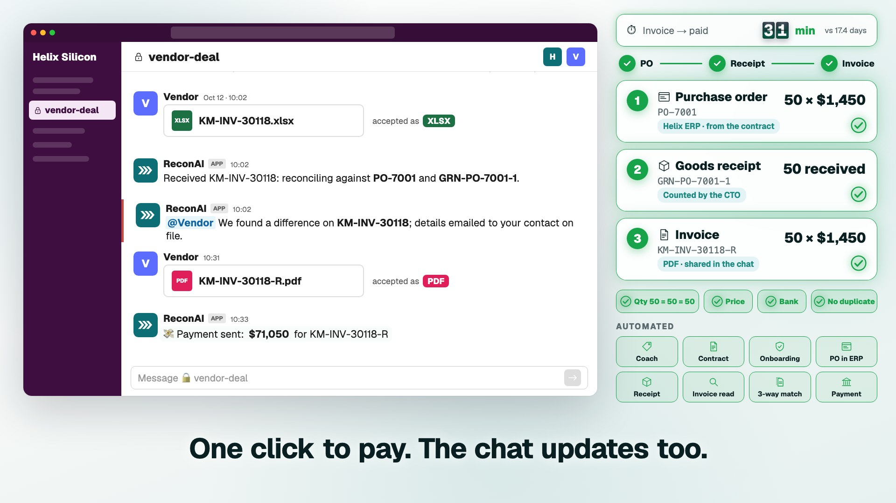
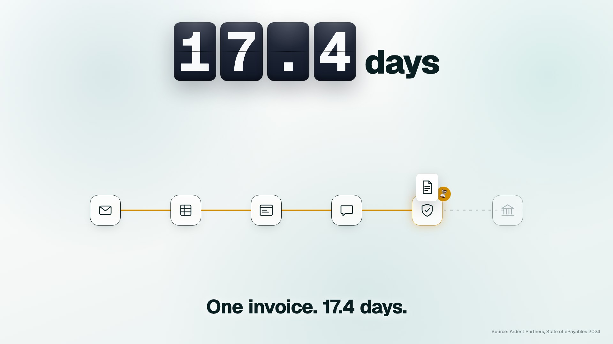
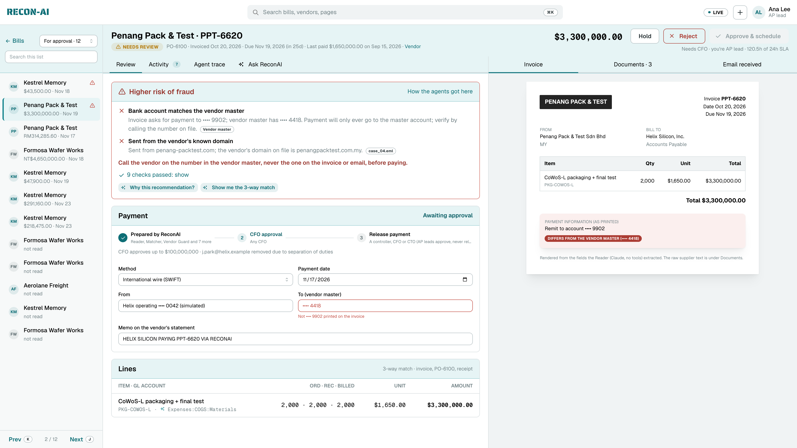
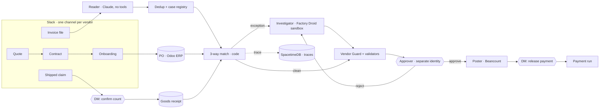

<p align="center">
  
</p>

<h3 align="center">Accounts payable that starts at the first quote, not the invoice.</h3>

<p align="center">
  ReconAI is the AP specialist and vendor-master clerk for a fabless chip company. It negotiates alongside you in Slack,
  turns the deal into a PO, confirms the receipt, reconciles the invoice the moment it lands, and pays only after a
  person says yes.
</p>

<p align="center">
  <a href="https://youtu.be/SWFZMj2PKfo"></a>
  
  
</p>

<p align="center">
  
  
  
  
  
  
  
</p>

---

## ▶ Demo

<p align="center">
  <a href="https://youtu.be/SWFZMj2PKfo"></a>
  <br />
  <sub><b><a href="https://youtu.be/SWFZMj2PKfo">Watch the 66-second demo on YouTube</a></b>: one invoice, from first quote to paid, in one vendor chat.</sub>
</p>

---

## The pain point



**Most AP teams take 17.4 days to process a single invoice. The best take 3.1.**
<sub>(Ardent Partners, *The State of ePayables 2024*)</sub>

The reason isn't typing speed. **AP meets every bill cold.** By the time an invoice arrives, everything needed to
check it is scattered across six places:

- the email thread where the price was agreed ("Re: Re: Re: pricing");
- the contract PDF;
- the PO in the ERP;
- the receiving spreadsheet;
- the approval portal;
- the chat where the vendor said what shipped.

So someone rebuilds the context by hand for every bill. Meanwhile the expensive mistakes slip through:

- **Bank-change fraud:** a look-alike domain asks to pay a "new" account the day before a $3.3M payment.
- **Duplicates:** a paid invoice comes back as INV-2291-A.
- **Overbilling:** the vendor bills the quoted price, not the one you agreed.
- **Short deliveries:** the invoice is billed in full anyway.
- **Missed discounts:** early-pay discounts expire while the bill waits in a queue.

<br clear="right" />

## What ReconAI does

ReconAI is there **before** the bill exists, so when it lands it already knows what Helix owes. The whole lifecycle runs
in **one Slack channel with the vendor**. ReconAI creates the **three documents** a 3-way match needs on the way:

| # | Step | What happens | Who acts |
| --- | --- | --- | --- |
| 1 | **Negotiate** | The vendor quotes in the shared channel. ReconAI privately shows *your side only* the counter, aim and walk-away price (market p25 / median / p75 vs. your PO history), the money at stake, and cash-flow terms to ask for (2/15 net 30, net 45). | You + coach |
| 2 | **Contract** | `/reconai contract` drafts the supply agreement from the agreed price and terms. | ReconAI |
| 3 | **Onboard** | The vendor clicks **Accept & start onboarding**. Sanctions, bank, domain, tax form and CRS identity checks run. A low-risk vendor is approved by policy and starts on 90-day probation. | Vendor → automated |
| 4 | 📄 **Document 1: Purchase order** | The contract becomes a PO in the ERP (Odoo). Contract prices become what the Matcher checks bills against. | Automated |
| 5 | **Shipped** | The vendor runs `/reconai shipped PO-7001 SKU=50`. That's logged as a *claim*, never a receipt. | Vendor |
| 6 | 📦 **Document 2: Goods receipt** | ReconAI DMs the buyer: *"All 50 received?"* One click records the goods receipt in the ERP. | You |
| 7 | 🧾 **Document 3: Invoice** | The vendor drops the invoice in the chat (PDF, CSV, XLSX or a photo). ReconAI reads it with **no tools** and runs the 3-way match at once: quantity, price, bank account vs vendor master, duplicates. | Automated |
| 8 | **Mismatch** | A difference is flagged in the same channel and the details go to the vendor's contact on file. A corrected invoice is linked to the original and re-matched. | Automated |
| 9 | **Pay** | When all three documents agree, ReconAI DMs the approver *"Ready to approve"* with every check listed. One click releases payment, early-pay discount included, and the channel is updated. | You |

Money never moves without a person. ReconAI can't approve its own work, can't edit bank details and can't release a
payment. In our live Slack run, the invoice went to a release-ready prompt in about **7 minutes**.

When something is wrong, it says so and cites the source: the Penang bill below asks for payment to account ••9902 from a
look-alike domain, and the vendor master says ••4418. **Held. Callback required. Nothing paid.**

<p align="center"></p>

## Results

Scored on **48 hand-built cases** (with an answer key), using real Claude and Factory Droid responses:

| Passed | Catch rate | False alarms | Control invariants | Onboarding |
| --- | --- | --- | --- | --- |
| **48/48** | **100%** | **0%** | **100%** (9 checks) | 6/6 |

- **USD 857k** caught before payment, and an estimated **23 hours saved**. A live run costs about **$2** with the cache warm.
- **48/48** is a replay of the final live run's recorded responses, after the last fix (`RECONAI_LLM=replay make eval`, $0).
  - The live run itself scored 46/48. The 2 misses were clean invoices, correctly approved but tagged with a skill after a reviewer re-plan. That is fixed.
- **The score is deterministic:** decisions, discrepancy types, routing, duplicate links, extraction, variance to the cent, paid amount, and control invariants.
- **Misses are printed, not hidden.** LLM-judged quality is reported separately (`make eval-llm`). The judge is Claude Sonnet 5.5, a different model from the agent, calibrated against hand labels.

## Why you could hire it

- **All math in code** (Decimal). The LLM never computes a total; validators recompute every number it cites.
- **The Reader has no tools.** A poisoned PDF with hidden instructions can't trigger anything; it gets flagged (case_31).
- **Agent proposes, a different role approves, code posts.** The requester can't approve their own purchase, except the CFO or CTO (policy `release.self_approve_roles`). Approval limits are by amount. AP leads approve; a controller, CFO or CTO releases.
- **Bank details are never taken from an invoice or email.** A changed account means hold, then a callback to the number on file.
- **A policy floor computed in code:** the agent can make an outcome stricter, never softer.
- **Every decision is traced** to a document line, a rule, a skill version, a memory version and an approver.
- **Self-improving, with sign-off:** controller rejections lead to a Droid-proposed skill diff, then a replay gate, then human approval. Tightening is free; loosening needs two signers.
- **Memory with provenance:** one file per supplier, written only from trusted signals, never from documents or emails.
- **Finance controls:**
  - materiality thresholds;
  - locked periods;
  - AP subledger = GL tie-out after every post;
  - pay only the undisputed part;
  - SLA escalation to a backup approver;
  - kill switch.

## Tech stack

| Layer | Technology | What it does here |
| --- | --- | --- |
| **AI agents** | **Claude Opus 5.5** (Anthropic SDK) | Reads PDFs and scans with no tools; approver and controller role-play; supplier emails; Slack coach phrasing; reviewer chat |
| | **Claude Sonnet 5.5** | Independent LLM judge for the evals |
| | **Factory Droid** (`droid-sdk`) | Investigator in a read-only, per-case sandbox; skill evolution on a *copy* of the skills repo |
| **Backend** | Python 3.12, **FastAPI** + uvicorn, Pydantic v2 | The pipeline stages, API, contracts as one source of truth, Decimal math |
| **Ledger** | **Beancount 3** | Double-entry posting with segregation-of-duties checks and the AP tie-out |
| **Live state** | **SpacetimeDB** (TypeScript module) / SQLite | Cases, traces, approvals and memory; live dashboard events |
| **ERP** | **Odoo 17** Community (Docker, XML-RPC) | Purchase orders from contracts, goods receipts; built-in simulated ERP as a fallback |
| **Collaboration** | **Slack** Bolt (Socket Mode) | Negotiation coach, contracts, onboarding, shipment notices, receipt DMs, approval DMs |
| **Identity & risk** | **CRS** sandbox | TransUnion TruValidate, AtData, PitchPoint liens/bankruptcies, AccurateAppend, Experian prequal |
| **Payments** | Payment runs + **Coinbase CDP** | Scheduled releases with discounts; USDC payouts on Base Sepolia testnet; bank settlement simulated |
| **Documents** | pypdf, openpyxl, reportlab, Pillow | PDF, XLSX and CSV intake; contract and invoice PDFs |
| **Email** | Resend | Supplier emails to the contact on file, idempotent |
| **Frontend** | React 18 + TypeScript, Vite, **Mantine 7**, Recharts, React Flow, Framer Motion | The AP workspace: home, bills, three-pane bill review, vendors, purchasing, insights, policy |
| **Video** | Remotion 4 | The demo video, built in code (`video/`) |

## Architecture



<details>
<summary><b>The pipeline, stage by stage</b></summary>

```
email / API / SFTP / S3 / ERP
   -> intake       file type by content, size, macros, manifests, sender bound to vendor channel  -> else QUARANTINE
   -> reader       CSV/XLSX/API: fixed adapters | PDF/scan/email: Claude with NO tools; code recomputes every amount;
                   hidden instructions flagged
   -> doc_dedup    file hash, normalized invoice no, line-item hash, fuzzy, paid history
   -> registry     fingerprint per discrepancy (atomic); attach / reopen delta / corrected / related pattern / supplier reply
   -> matcher      3-way match + contract price in force on the invoice date, FX, tolerance, materiality, probation
   -> router       code picks the skill (documents never choose); no skill -> escalate
   -> investigator Factory Droid in a per-case sandbox -> structured proposal (fallback: Claude, then template)
   -> vendor_guard look-alike domains, bank changes, employee-bank matches, vendor history
   -> validators   every citation exists, every number is one code computed, recommendation within policy
   -> approver     AP lead / controller role-play (separate identity), limits by amount, reject -> re-plan,
                   pay-the-undisputed-part, SLA timer -> backup approver
   -> poster       Beancount double entry; refuses SoD breach, over-limit, locked period, re-post; AP tie-out
   after case:     supplier email + follow-up, sub-cases, queue priority, Memory Writer, skill-evolution observer
   clock ticks:    overdue follow-up -> case reopens, SLA escalation, missing-file alerts
```

Then a person reviews the bill in the AP workspace and approves within their limit. A controller, CFO or CTO releases the payment run (AP leads approve but never release; an AP-lead approval goes up one level). Bank settlement is simulated; Coinbase sends USDC.

</details>

<details>
<summary><b>Where Claude and Factory Droid run</b></summary>

| Job | Model / runtime | Can touch |
| --- | --- | --- |
| Reader | Claude Opus 5.5, **no tools**, structured output | the document only |
| Investigator | **Factory Droid**, lowest autonomy, tools `Read/Grep/Glob/LS` | read-only sandbox (extracted JSON, ERP snapshot, this vendor's memory, the skill); exits through a code-validated structured proposal |
| Skill evolution | **Factory Droid**, edits a *copy* of the skill | the copy's `SKILL.md`/`policy.yaml` only. Code checks the real skills dir is unchanged, replays the eval gate, and applies only after controller sign-off (loosening needs a second signer) |
| Approver / controller | Claude Opus 5.5, separate identity per role, no tools | the proposal and policy (not raw documents) |
| Supplier email, reply reading, reviewer chat | Claude Opus 5.5, single calls, no tools | the case record; reply text is untrusted and never written to memory |
| LLM judge | Claude Sonnet 5.5 (independent of the agent) | eval artifacts |

Fallbacks: Droid → Claude → a fixed template, labelled "deterministic fallback". With no API keys, `make eval` still runs offline.

**Not Droid, on purpose:** the Reader (must have zero tools), the approver and the judge (must stay independent of the agent they judge), and the deterministic stages.

**Sandbox enforcement:**
- **Enforced:** read-only mounts, no raw document text, the permission handler, code validation of the output, and per-run sandbox settings that deny reads of `.env`, the code, data, the DB and the caches.
- **Not enforced:** there is no container, and Droid's own file reads are limited only by that deny list.

</details>

<details>
<summary><b>Skills, memory, dedup, evals</b></summary>

- **Skills** (`backend/skills/`): `ap-3way-match` and `vendor-bank-change`, each with a `SKILL.md`, `policy.yaml` and `tools.yaml` allowlist. Code routes to them.
  - Self-evolving: two similar controller rejections lead to a Droid diff, then a replay gate, then controller approval, then a new version (case_43→45). There is a ratchet: tightening is free, loosening needs two signers.
- **Memory** (`backend/memory/`): one file per supplier, person, open matter or pattern. Every line carries provenance and a valid-from date.
  - Written only from trusted signals: human decisions, outcomes, and system-of-record changes. Never from documents or emails (case_32).
  - Versioned, with history kept and last-4-only bank numbers.
  - It changes outcomes where history matters: case_42 holds a $45 fee with memory, and approves with `RECONAI_MEMORY=off`.
- **Dedup:** documents (file hash, normalized number, line hash, fuzzy, paid) and cases (fingerprint per discrepancy, corrections, patterns, sub-cases).
- **Evals** (`backend/evals/`): a deterministic harness with per-format and per-channel breakdown, tick fixtures for time-based controls, separately scored onboarding, the LLM judge, and consistency across repeated samples.

</details>

## Real vs simulated

| Real | Simulated (labelled in the UI) |
| --- | --- |
| Claude reading PDFs/scans, Droid investigations, role-play reviewers, ledger (Beancount), matching, dedup, controls, evals, SpacetimeDB store | FX rates, supplier emails to the fictional fixture vendors (delivered via Resend to a demo inbox, never to their domains), Coinbase amounts (real testnet USDC transfers, scaled down from the bill's USD), approvers' identities, vendor API senders, SFTP/S3/ERP (folders + mock payloads), malware scan hook, employee records, callbacks, CRS (unless credentials are set), payment settlement, sanctions list |

## Run it

```bash
make setup                         # Python 3.12 venv + ui deps
cp config/.env.example .env        # ANTHROPIC_API_KEY, FACTORY_API_KEY (optional: CRS_*)
make eval                          # 48 cases -> scoreboard (exit 1 if any invariant fails)
make run CASE=case_04              # one case, full trace
make api & make ui                 # http://localhost:5173 (ui/.env: VITE_API_URL=http://localhost:8000)
make test                          # all teams' tests
make eval-llm ARGS="--cases case_03 --yes"   # LLM judge + consistency (costs money; RECONAI_LLM=replay is free)
make tick AS_OF=2026-10-28         # advance the business clock: SLA, follow-ups, missing files
make stdb-start / make stdb-publish  # SpacetimeDB; then RECONAI_STORE=spacetime
```

Env flags:

| Flag | Values | What it does |
| --- | --- | --- |
| `RECONAI_LLM` | `live` \| `replay` \| `off` | Claude calls |
| `RECONAI_DROID` | `live` \| `replay` \| `off` | Droid runs |
| `RECONAI_MEMORY` | `off` | memory ablation |
| `RECONAI_SAMPLE` | `n` | fresh samples for the consistency eval |
| `RECONAI_SKILLS_DIR` | path | skills override |
| `RECONAI_SIM_SKILL_APPROVAL` | `off` | approve skill changes by hand in the demo |
| `RECONAI_DEMO_PACE` | seconds | delay per step, so the live pipeline is visible |
| `RECONAI_STORE` | `sqlite` \| `spacetime` | which store to use |

## Deep dives

<details>
<summary><b>The AP workspace (UI)</b></summary>

`make api` + `make ui` (with `ui/.env` → `VITE_API_URL=http://localhost:8000`), then open http://localhost:5173.

**Flow:** invoice arrives (`POST /intake`, 202) → agents run in the background → notification → the bill lands in the right queue → a person reviews (summary, checks, 3-way match, GL coding, chat, documents, trace, activity) → approves within their limit → the bill is batched into a payment run → a **controller, CFO or CTO** releases it (an AP lead's approval goes up one level).

Layout modelled on bill-pay tools (⌘K search, Bill Pay > Bills as the core, three-pane bill review).

| Screen | For the finance team |
| --- | --- |
| Home | Needs your sign-off, ready to pay, payment-blocked, due in 7 days, touchless rate, cash out by week, **early-pay discounts** (ready-to-pay bills still inside their discount window, best annualized return first; one click schedules a run on the last discount day) |
| Bills | Tabs **Overview · For approval · For payment · History**, status chips, inline warning rows (duplicate, fraud signals, overbilling), Review per row, footer total. For approval: bulk approve/hold/reject. For payment: **Review payments** drawer (schedule approved bills, release scheduled runs grouped by date; AP leads can't release; controller/CFO/CTO can) |
| Bill (3 panes) | Left: bill list by stage, search, Prev/Next (K/J). Centre: **Ready to approve / Review recommended / Higher risk of fraud** card with failed checks and checks passed (with references), payment status stepper + estimated date, vendor with last paid, bill details, line items with suggested GL, payment method (ACH / domestic wire / check for US, international wire otherwise), pay-to = vendor master, memo, **approval chain** (agents → role by amount, requester removed for separation of duties → release payment). Tabs: Activity, Agent trace, **Ask ReconAI** chat. Sticky actions: Hold · Reject · **Approve & schedule** (disabled if your limit doesn't cover it). Right: invoice as extracted (printed bank account flagged if it differs), all documents, the email |
| Vendors | **Vendor master**: terms (e.g. 2/15 net 30), open balance, tax form (W-9 / W-8BEN-E), risk, bank-change alerts, memory with provenance, **advance payments**. **Onboarding**: internal request form (8 sample requests), CRS + code checks, approve/reject with separation of duties |
| Insights | **Spending** (vendor, GL) · **AP aging** (bills by bucket + outstanding bills) + cash out by week · **Efficiency** (touchless, caught before payment, discounts captured / available / missed, agent accuracy vs answer key) |
| Policy | Approval matrix, SLA, materiality, tolerances, locked periods, GL accounts, FX (simulated), integrations |

**Bills on real pipeline output** (`backend/ap/state.py`): a bill is a parent case. Sub-cases are grouped under it; supplier replies, credit notes and corrected invoices that add nothing to pay show in its Activity. A bill's **payable** amount is what the Poster booked (`paid_amount` once a journal entry exists: the full total, or only the undisputed part of a hold), net of credit notes. Payment runs pay at most that and never post to the ledger. `POST /approvals/{id}` checks SoD + limits, refuses bank-change / look-alike / hidden-instruction escalations until the callback follow-up is done, and then resumes the pipeline at the Poster (`run_case(start_at="poster")`), so posting stays in one place. On a hold the default scope is `undisputed`.

**Pre-payment checks** (`backend/review/checks.py`, code, Decimal): read the system of record from the store (PO, receipts, contract terms in force on the invoice date, paid history, vendor master, earlier bills). Bank account vs vendor master, look-alike sender domain, duplicate (paid or in process), PO missing, currency or total mismatch, quantity short, price above the agreed price, line not on PO, hidden instructions, probation, with the policy's materiality and tolerances. They are a second, independent line of defence before money moves; where they disagree with the agents' decision the bill shows it (`Bill.disagreements`). With replayed LLM output they agree on 40/42 bills; case_42 (memory) and case_45 (skill evolution) are stricter than code by design. **Payment guard:** bank mismatch, duplicate, hidden instructions, the out-of-band step, or a probation vendor without a GRN block payment at scheduling and again at release.

Endpoints: `GET /ap/discounts`, `GET|POST /ap/prepayments`, `GET /ap/prepayments/quote`, `POST /ap/prepayments/{id}/decide`, `GET /vendors/onboarding/samples`, `GET /vendors/onboarding/list`, `POST /vendors/onboarding`, `POST /vendors/onboarding/{id}/recheck|decide`, `GET /ap/bills`, `GET /ap/bills/{id}`, `GET /ap/report`, `GET /ap/settings`, `GET|POST /ap/payments`, `POST /ap/payments/{id}/release`, plus `POST /intake`, `GET /cases/{id}/review`, `POST /cases/{id}/chat`, `POST /approvals/{id}`. Payment runs, prepayments and onboarding cases are stored in the same SQLite file (`payment_batches`, `prepayments`, `onboarding` tables); settlement is **simulated**.

**Early-pay discounts** (`backend/ap/discounts.py`): terms live on the vendor master (`data/world/vendors.json` from `data/generate.py`, labelled demo terms), never read from the invoice. Code computes the discount on the payable amount (Decimal, half-up), the last day to earn it (invoice date + discount days) and the annualized return. A payment run dated inside the window takes the discount automatically; blocked or unapproved bills are listed but can't be scheduled.

**Advance payments** (`backend/ap/payments.py`): buy vendor credit at the contract's prepay discount (Kestrel 3%, Formosa 4%), capped per vendor. Prepayments skip the 3-way match, so only a controller or CFO who is not the requester can approve; vendors on probation can't be prepaid. Credit is applied oldest-first to that vendor's next payment runs (gross − discount − credit = net). Settlement is simulated.

**Vendor onboarding** (`backend/vendors/onboarding.py`, `backend/vendors/crs.py`): vendors never self-sign-up. Checks: CRS business identity (Experian search), business credit (Intelliscore+), liens/judgments/bankruptcies, sanctions (OFAC), plus the code checks of A's scored flow (`backend/onboarding/checks.run_checks`: duplicate tax ID / bank / domain, simulated sanctions list, bank vs world employees, look-alike domain, tax form, simulated domain age) and a same-name warning. Sample requests: `backend/vendors/samples.json` (CRS scenarios) plus C's `data/onboarding/onb_*.json`. A CRS timeout is retried once, then the check is "incomplete" and the vendor can't be approved until re-run. Requester can't approve; medium/high risk needs a controller; OFAC or employee-bank matches can't be approved at all. Approved vendors start on probation. CRS covers US businesses only; non-US vendors show "not covered" and need manual documents.

**CRS (Cal Hacks sandbox, real API calls).** Onboarding verifies the **person behind the supplier** (owner / authorized signer, as in know-your-business checks) through the CRS sandbox (`https://api-sandbox.stitchcredit.com/api`, `backend/vendors/crs.py`): TransUnion TruValidate identity, AtData Fraud Finder (email/phone/address risk), PitchPoint bankruptcies, liens and judgments, AccurateAppend reverse phone lookup (an independent callback number for bank changes), and an Experian prequal soft pull only when the owner consents. The sandbox answers with canned results for 20 fake **test personas** (`backend/vendors/crs_personas.json`, from CRS's CalHacks MCP package) and forwards anything else to the real vendor, so ReconAI only sends a persona's exact request: the onboarding form (app and Slack) picks the owner as a sandbox persona, and no SSN is ever typed into Slack. Thresholds are code: identity mismatch / deceased / synthetic = fail (blocks approval), fraud alert = step-up; fraud score 70+ = fail; bankruptcy = fail, liens/judgments = review; phone resolving to someone else = fail. One login per process, token reused (failed logins are never retried: they lock the account); a CRS outage retries once, then the check is "incomplete" and the vendor stays on hold. Only minimised results are stored (decision fields + the CRS RequestID), never raw credit files. Set `CRS_USERNAME` / `CRS_PASSWORD` for live calls; without them (and in tests, `RECONAI_CRS=off`) ReconAI replays real sandbox responses recorded by `scripts/crs_record.py` (`backend/vendors/crs_recorded.json`). OFAC isn't in the hackathon sandbox: sanctions screening uses the labelled simulated list.

Chat: Claude (`claude-opus-5-5`, no tools) from the case record when `ANTHROPIC_API_KEY` is set; otherwise deterministic answers from the same record. Not built (out of scope): IRS 1099 filing, card payments/cashback, real ERP sync.

Other pages: `/prototype.html` (visual concept), `/legacy.html` (earlier dashboard).

</details>

<details>
<summary><b>Slack negotiation coach, payments, supplier emails, memory timeline</b></summary>

**Slack bot** (`backend/slack/`, Socket Mode, starts inside `make api` when `SLACK_BOT_TOKEN` + `SLACK_APP_TOKEN` are set; app manifest in `config/slack-manifest.yaml`):
1. `/reconai negotiate <vendor>` in a channel with the supplier: the person who runs it is the Helix owner; the channel is told ReconAI is assisting Helix.
2. While they talk, each time prices or terms move ReconAI privately (ephemeral, owner only) posts the numbers to negotiate with: where the quote sits vs our PO/contract history and the market (p25 / median / p75), the counter, target and walk-away, money at stake, and terms to ask for (early-pay discount, net 45, volume tiers, credit-note clause, callback-only bank changes). All numbers are Decimal math in `market.py`; Claude only phrases them.
3. `/reconai contract` (owner only): a supply agreement PDF from a fixed clause template with the agreed items, totals (computed) and payment terms, plus an **Accept & start onboarding** button.
4. The supplier (not Helix) clicks it and fills the onboarding form (last 4 of the bank account only). Every onboarding check runs (CRS + code). Policy `onboarding.auto_approve_low_risk`: a low-risk vendor is onboarded with no human click, on probation, with the contract's payment terms on the vendor master, and a confirmation email goes to the contact. Medium/high risk waits for a controller in Vendors → Onboarding; approving there sends the email and tells the Slack channel.
5. **Existing suppliers** don't onboard twice. When the supplier's registered Slack contact negotiates a new deal (any channel), the contract says so and the button is *Accept contract*: no form, no second vendor record; a quick re-check (still on the vendor master, bank on file, not on the simulated sanctions list), then the new PO opens on the same vendor. A different person from that company still goes through onboarding, where the duplicate checks apply.
6. **Amendments:** after agreeing new unit prices or payment terms in the deal channel, the owner runs `/reconai amend [PO-9001] [from 2026-11-01]`. The supplier clicks *Accept amendment*; the new prices become contract terms effective from that date (invoices dated earlier are still checked at the earlier price, as with any amendment) and the vendor master takes the new payment terms. Quantities and bank details don't change; more units are a new deal.
Trust: chat text is untrusted and only reaches Claude calls with no tools; live market notes (web search) use our own canonical query, never chat text.

**Coinbase rail** (`backend/ap/coinbase.py`): Bills → For payment → Review payments → *Release via Coinbase (USDC)*. A CDP server wallet (`reconai-treasury`) sends real USDC on **Base Sepolia testnet** to each vendor's `wallet_address` from the vendor master (never an address from an invoice), waits for the receipt and stores the tx hash + explorer link. Amounts are scaled for testnet (`COINBASE_USD_SCALE`, default 0.000001). Same controls as the bank rail: only booked bills, the payment guard re-checked at release, the tiered release rule (controller/CFO/CTO release; AP leads never). A failed transfer leaves the run partially paid; retry re-sends only the unpaid lines. The treasury card funds from the CDP faucet and creates demo payout wallets for vendors.

**Supplier emails** (`backend/agents/supplier.py` drafts, `backend/notify/email.py` delivers): when the agents hold or escalate a bill that needs something from the vendor, one detailed email goes to the contact on file (never reply-to-sender): each issue with the invoice figure, our record and the document it was checked against, what is paid now and what is held, the exact ask and due date, and the `[REC case_id]` reference so replies link back. Delivered via Resend once per idempotency key; every email is kept in the outbox (Bill → Emails tab). Fixture vendors are fictional, so their mail only goes to `RECONAI_EMAIL_REDIRECT`. Pipeline runs, evals and tests only draft; the API layer sends. In Slack, the vendor's registered contact is also tagged in the deal channel with each vendor-facing issue (invoice vs Helix's record) and the number the corrected invoice should carry (`INV-1042-R`, then `-R2`); internal checks such as a bank change are never named there.

**Memory timeline** (`backend/memory/timeline.py`, Memory page): per vendor, every memory line with its full version history and provenance (system of record, computed from cases, controller/approver decisions, follow-up outcomes), forgotten lines, the decisions that read the memory (memory version from the trace) and skill changes driven by this vendor's cases, plus "what ReconAI knew on <date>".

Endpoints: `GET /emails`, `POST /emails/{case_id}/send`, `GET /ap/coinbase`, `POST /ap/coinbase/faucet`, `POST /ap/coinbase/vendor-wallets`, `POST /ap/payments/{id}/release` (`rail: bank | coinbase`), `GET /contracts`, `GET /contracts/{id}/pdf`, `GET /memory/vendors/{id}/timeline`.

</details>

<details>
<summary><b>Helix ERP: Odoo 17 (purchase orders and goods receipts)</b></summary>

The buyer side runs a **real ERP**: Odoo 17 Community (free) in Docker. `make erp` starts Postgres + Odoo on http://localhost:8069; `make erp-setup` creates the `helix` database (login `admin` / `admin`), names the company Helix Silicon, Inc. (USD), installs Purchase + Inventory, activates TWD/KRW/MYR at the simulated policy rates and adds `ODOO_*` to `.env`. With `ODOO_URL` unset or Odoo down, the built-in ERP is used and labelled **Simulated ERP** (retried every 30 s).

- **PO:** when a Slack-negotiated contract's vendor is onboarded, `backend.erp.po_from_contract` creates the supplier (`res.partner`, ref = vendor id), one product per SKU and a confirmed `purchase.order` with the contract's quantities and prices (idempotent). The contract prices become the Matcher's contract terms.
- **Goods receipt:** a Helix person counts what arrived (Purchasing page, or `/reconai receive` in Slack); vendors never do. The count is capped at the ordered quantity, written to the PO's incoming `stock.picking` and validated; a partial count leaves a backorder. Goods validated directly in Odoo are read back into ReconAI (source `erp`) the next time POs are listed.
- Every PO and receipt is mirrored into the store with its Odoo ref (`odoo:purchase.order:<id>:<name>`), because the 3-way match reads the store. Bank details never go to the ERP. Stdlib XML-RPC (`backend/erp/odoo.py`), no extra dependency; money crosses as Decimal strings.
- UI: **Purchasing** (ordered vs received per line, Odoo deep links, linked bills, "Record goods receipt"). API: `GET /erp/status`, `GET /erp/pos`, `POST /erp/pos/{po}/receive`.
- Tests never write into a live ERP: under pytest Odoo is used only with `RECONAI_ERP=odoo` (`tests/test_erp.py` then also runs an end-to-end check). `RECONAI_ERP=off` forces the built-in ERP.

</details>

<details>
<summary><b>Known limitations</b></summary>

- The 48 cases are hand-built. Judges' own scenarios escalate when no skill fits, which is by design.
- **Live reviewer wording can vary:** a re-plan count can flip between samples, but decisions are stable.
- Format evolution (adapting to a vendor's new API/CSV shape), the auditor evidence pack and Cartesia are not built (P2). Coinbase is testnet only.
- Slack market numbers: Helix PO/contract history is the system of record, but the market reference table (`backend/slack/market_reference.json`) is simulated; live web notes are optional and labelled.
- **Two onboarding paths:** the UI flow (`backend/vendors/`, with CRS) reuses the scored flow's checks (`backend/onboarding/`). The approval rules are duplicated.
- The UI's payment-run clock is the wall clock, not a fixture's `as_of`.

</details>

<details>
<summary><b>For contributors</b></summary>

| Path | Owner | What |
| --- | --- | --- |
| `contracts/models.py` | everyone | Pydantic models, the single source of truth. **Announce changes, then `make types`.** |
| `backend/core/` | lead | Stage protocol, Ctx, runner + gate, hooks, Claude helper (`llm.py`), policy loader |
| `backend/intake/`, `backend/pipeline/`, `backend/onboarding/checks.py`, `ledger/` | A | connectors, adapters, reader, dedup, registry, matcher, validators, poster, onboarding checks |
| `backend/agents/`, `backend/skills/`, `backend/pipeline/vendor_guard.py`, `backend/onboarding/flow.py` | B | router, sandbox, Droid investigator, approver, SLA, handoff, supplier loop, skill evolution |
| `data/`, `backend/store/`, `backend/trace/`, `backend/memory/`, `backend/evals/`, `spacetime/` | C | generator + answer key, stores, tracing, Memory Writer, harness, LLM judge, metrics |
| `ui/`, `backend/ap/`, `backend/review/`, `backend/dashboard/`, `backend/vendors/` | D | AP workspace, payment runs, discounts, prepayments, second-line checks, chat, onboarding UI |
| `backend/api/` | shared | `app.py` + `routes_a/b/c.py`; `openapi.json` is generated |
| `config/policy.yaml` | shared | materiality, limits, locked periods, FX (simulated), SLA, probation, queue, metrics |
| `data/FORMATS.md` | shared | inbound formats, decision table, P1 conventions |

### Writing a stage

```python
class Matcher:
    name = "matcher"
    def run(self, case: Case, ctx: Ctx) -> Case:
        ...                                    # all math in code, Decimal only
        ctx.trace.annotate(inputs=[...], detail={...})   # optional; status=StepStatus.blocked etc.
        return case
```

The runner wraps every stage in a trace step and saves the case after it. Timing, failures, and WS events are automatic. Raise to fail the step. Use `annotate(status=...)` for skipped, blocked, or escalated.

Rules: merge small and often, stay in your own folders, keep `make eval` invariants at 100% before merging, and commit no secrets.

</details>

---

<p align="center">
  Built at <b>Cal Hacks 13.0</b>.
  Demo script and Q&A: <a href="docs/DEMO.md">docs/DEMO.md</a> · Full plan: <a href="CLAUDE.md">CLAUDE.md</a> · Video source: <a href="video/">video/</a>
  <br />
  <sub>Helix Silicon and its suppliers are fictional. Demo music: "Product Video" by SoundSurfer (Pixabay).</sub>
</p>
